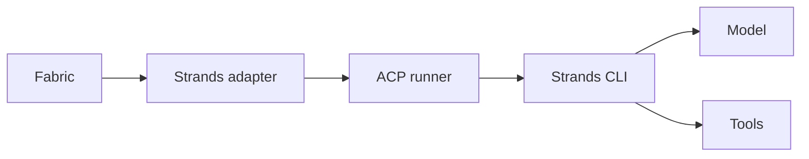

<!--
SPDX-FileCopyrightText: Copyright (c) 2026, NVIDIA CORPORATION & AFFILIATES. All rights reserved.
SPDX-License-Identifier: Apache-2.0
-->

# AWS Strands ACP Adapter

Run the standard [AWS Strands harness](https://github.com/strands-agents/harness-sdk/tree/main/strands-cli) through NVIDIA NeMo Fabric. The `nvidia.fabric.strands` adapter launches `strands --acp-server` using the [shared ACP runner](../common/acp-runner.md), retains one conversation per NeMo Fabric runtime, and submits ordered text invocations.



The adapter starts the CLI with `strands --acp-server --agent <project>/agent/agent.ts`. The project is a small agent project the adapter writes into the runtime's isolated home for each runtime and removes when the runtime stops. It is the only place a Strands agent can carry what the CLI flags cannot say: a called agent with its own instructions, tools, skills and MCP servers, a Cedar authorization policy, and a turn limit. The source files are static; every value from the configuration or from an agent package goes into one `spec.json` and is never spliced into source text. The adapter never loads agent source it did not write.

## Install

Use Node.js 22.19 or newer. Install the harness separately; it is not a dependency of the adapter. The tested CLI releases are 0.2.1 and 0.4.0.

```bash
npm install --global @strands-agents/cli@0.4.0
```

For a source checkout, run from the repository root:

```bash
just install-typescript-strands
npm run build --prefix adapter-contract/typescript
npm run build --prefix adapters/typescript --workspace nemo-fabric-adapters-common
npm run build --prefix adapters/typescript --workspace nemo-fabric-adapters-strands
```

The published adapter package is `nemo-fabric-adapters-strands`. Its descriptor is `strands.fabric-adapter.json` in the installed package. NeMo Fabric's Python adapter catalog also includes the descriptor; source development can select it explicitly as below.

## Configure an Agent Invocation

```python
import asyncio
from pathlib import Path

from nemo_fabric import (
    DiscoveryConfig, EnvironmentConfig, Fabric, FabricConfig, HarnessConfig,
    InstructionConfig, InstructionsConfig, MetadataConfig, ModelConfig, RuntimeConfig,
)

root = Path.cwd()
config = FabricConfig(
    metadata=MetadataConfig(name="strands-review"),
    discovery=DiscoveryConfig(local_paths=[
        root / "adapters/typescript/strands/strands.fabric-adapter.json",
    ]),
    harness=HarnessConfig(adapter_id="nvidia.fabric.strands", settings={"builtin_tools": ["read"]}),
    models={"default": ModelConfig(
        provider="nvidia",
        model="nvidia/nemotron-3-nano-omni-30b-a3b-reasoning",
        base_url="https://integrate.api.nvidia.com/v1",
        api_key_env="NVIDIA_API_KEY",
    )},
    instructions=InstructionsConfig(system=InstructionConfig(
        mode="append", content="Read the relevant files before reviewing correctness.",
    )),
    environment=EnvironmentConfig(provider="local", workspace=root, artifacts=root / "artifacts/strands"),
    runtime=RuntimeConfig(input_schema="text", output_schema="message", artifacts=root / "artifacts/strands"),
)

async def main():
    async with await Fabric().start_runtime(config, base_dir=root) as runtime:
        result = await runtime.invoke(input="Review README.md for unclear setup instructions.")
        print(result.status, result.output)

asyncio.run(main())
```

Only the `default` model role is supported. With no configured model, Strands selects its native Bedrock default. To select a Bedrock model explicitly, use `ModelConfig(provider="bedrock", model="<Bedrock model ID>")` without `base_url` or `api_key_env`. Configure the AWS SDK credential chain and region before starting NeMo Fabric. AWS profiles and SSO caches remain accessible through the runtime's isolated home.

For Chat Completions endpoints, use provider `openai` or `nvidia` and an explicit `base_url`. Both map to Strands' native `litellm/` profile, which creates a direct OpenAI-compatible Chat Completions client; a LiteLLM proxy is not required. The model ID is passed unchanged after the profile prefix. The CLI's `openai/` profile uses the Responses API, so it is not used for this mapping.

Set `api_key_env` to the name of a credential in the task environment or parent process. An explicitly named but unavailable credential fails startup. Omit it for a keyless endpoint; the client receives a nonsecret placeholder credential. HTTPS and loopback HTTP are accepted. For a trusted HTTP server elsewhere, add its hostname or IP to `harness.settings.insecure_http_model_hosts`:

```python
config.models["default"] = ModelConfig(
    provider="openai", model="<served model ID>", base_url="http://model-server:8000/v1",
)
config.harness.settings["insecure_http_model_hosts"] = ["model-server"]
```

Query the endpoint's model catalog for its served ID. Strands does not provide a model server, translate model names, or make unsupported tool calling work on a model.

## Tools, Instructions, and MCP

`instructions.system` supports `append` only. The CLI appends domain instructions to the harness system prompt. Replacement fails planning and direct adapter startup.

| Harness setting | Default | Behavior |
| --- | --- | --- |
| `builtin_tools` | `shell`, `read`, `write`, `edit` | Select from these tools and `web_fetch`; an empty list disables these tools. |
| `max_invocations` | `100` | Maximum dispatched invocations in one conversation, from 1 to 10,000. Start a new runtime when exhausted; history is not silently reset. |
| `insecure_http_model_hosts` | `[]` | Explicit hostnames or IPs allowed for HTTP model endpoints outside loopback. |

Skills come from NeMo Fabric's normalized `skills.paths`. Each path is one skill folder that holds `SKILL.md`, and the adapter passes them to the CLI as `--skills`. With no paths, skills are off and the CLI's own skill discovery stays disabled. A path that is missing or holds no `SKILL.md` fails startup with `strands_skill_invalid`.

Called agents, plugins, hooks and a turn limit have no equivalent in this adapter. The CLI has a generic `subagent` delegate, not a named agent with its own instructions, tools and model, so an agent package's called agents are not mapped. The load report names them `not_mapped`.

The standard Strands ACP server executes enabled tools with the task environment's permissions. There is no adapter permission mode or normalized tool-policy support. Tool selection is not an operating-system sandbox; use an appropriate NeMo Fabric environment when running untrusted tasks.

Configure MCP through NeMo Fabric's normalized `mcp.servers`, not harness settings:

```python
import sys

config.add_mcp_server(
    "probe", transport="stdio", url=sys.executable,
    args=[str(root / "tests/_utils/probe_mcp_server.py"), "--marker", "/tmp/probe-called", "--token", "example"],
)
```

The adapter supports stdio, streamable HTTP, and SSE. Stdio requires an absolute executable. Remote servers require HTTPS except on loopback. Explicit headers can reference `${ENVIRONMENT_VARIABLE}` values; task environment values take precedence over parent values. ACP-transport MCP, normalized authentication objects, per-server tool filters, and MCP extensions are rejected. Strands initializes the agent and supplied MCP clients before returning the new-session response, so no Kiro-specific readiness notification is needed.

## Lifecycle and Boundaries

Each runtime owns one child process, an isolated temporary CLI home, and one live ACP session. Personal CLI profiles, MCP discovery, skill discovery, session persistence, long-term memory, and the todos plugin are disabled. The native environment plugin supplies workspace context. Background tool execution is disabled so tool work stays within its invocation. The adapter inherits a small process/AWS environment and applies explicit task environment values. It preserves access to the caller's `.aws` directory for native credential resolution. The temporary home is removed after stop or startup failure.

Warm invocations retain conversation history without saving it to the workspace. Deadline expiry attempts ACP cancellation, invalidates the session, and terminates its process group. If cleanup fails after an invocation error, the runtime retains the session for a later `stop()` retry while rejecting further invocations and replacement sessions. Stop is idempotent. The adapter supports text input and returns `{ "response": "..." }`, with ACP session ID and stop reason in result metadata. Non-success stop reasons become failed or cancelled results.

Strands CLI usage is invocation-local and is not differenced across turns. Inclusive input, output, total, and cached-read counters are normalized when valid. Output totals include reasoning tokens; the adapter records this inclusion in `nemo_fabric.detailed_token_usage.v1` without inventing a separate reasoning count. Cache writes are retained in `nemo_fabric.detailed_token_usage.v1`. Missing or malformed usage remains unknown without discarding a completed response. Strands CLI 0.2.1 reports zero cache counters even when the provider omitted them. The adapter therefore omits zero cache-read and cache-write counts, including genuine zeros, preserves positive counts, and retains inclusive input/output totals. This workaround is specific to Strands; it does not change other adapters’ handling of reported zeros. Cost is not estimated. Public cancellation, native OpenAI streaming, live updates, services, Relay telemetry, normalized runtime limits, and normalized skills are not advertised.

## Validate

Credential-free adapter tests:

```bash
npm test --prefix adapters/typescript --workspace nemo-fabric-adapters-strands
uv run pytest tests/adapters/test_strands_adapter.py
```

Live tests run conversation continuity, independent-runtime isolation, a real MCP tool on the first turn, and a native workspace read. Set `STRANDS_TEST_MODEL` to a Bedrock model ID and configure AWS credentials/region, or select a Chat Completions endpoint:

```bash
export RUN_FABRIC_STRANDS_INTEGRATION=1
export STRANDS_TEST_MODEL='<served model ID>'
export STRANDS_TEST_BASE_URL='http://localhost:8000/v1'
# For an authenticated endpoint, also set STRANDS_TEST_API_KEY_ENV to the credential variable name.
uv run pytest tests/e2e/test_strands.py
```

The [code-review example](../../../examples/code_review_agent/README.md) includes `--variant strands` for a runnable application.

## Runtime Health

Strands supports `live` through `Fabric.check()`. `live` reads the owned ACP child process exit and signal state. The pinned Strands CLI has no qualified read-only session health request, so `active` and `ready` return `unsupported`. A retained Fabric handle does not establish liveness.

Checks remain independent of an invocation. A busy invocation is healthy. Checks use the caller deadline and never cancel an invocation, stop the runtime, or repair a failure. Health does not establish valid model credentials, provider access, MCP connectivity, or successful model output. Reports contain only the generic health contract fields.

Refer to the [SDK health-check overview](../../../docs/sdk/health-checks.mdx) for shared behavior and a comparison of native evidence across adapters.


## Invocation deadlines

Strands prompt deadlines and already-expired invocation deadlines use canonical error code `timeout`. Error metadata retains `owner: "adapter"` and the native cause (`strands_prompt_timeout` or `strands_deadline_exceeded`), plus the enforced timeout in seconds or the absolute `deadline_millis`. Prompt expiration invalidates the session and attempts process cleanup. Startup and transport failures keep their existing error classifications.

When `runtime.timeout_seconds` is omitted or null, NeMo Fabric does not impose a total prompt deadline. An explicit invocation deadline is forwarded to the ACP session; startup and shutdown remain separately bounded.

## What an Agent Package Becomes

`Fabric.start_agent_package` maps an [agent package](../../../docs/sdk/agent-packages.mdx) onto this adapter. Each row names where the part lands in the generated Strands agent, or says that Strands has no place for it; the load report names every part the same way.

| Package part | In Strands | Maps |
| --- | --- | --- |
| instructions | `instructions`, appended to the harness system prompt | yes |
| model | `model` as `bedrock/<id>` or the LiteLLM profile (the config binds it; the package never does) | yes |
| skills | `skills`, one folder per skill | yes |
| connectors | `mcpServers` of the agent | yes |
| the agent's `tools` | `builtinTools` as an exact list (`read_file`, `write_file`, `edit_file`, `shell`, `web_fetch`, `web_search`); a package with called agents and no tool list gives its agent none | yes |
| called agents | one harness agent each, handed to the lead as a tool named for the agent, with its own instructions, tools, skills, plugin skills, MCP servers and model | yes |
| a called agent's `max_turns` and the agent's own | a handler that denies the model call after N per invocation | yes |
| `tools.blocked` of the config | removed from `builtinTools` and forbidden in a Cedar policy | yes |
| `max_depth` | a called agent has no tool to call another agent | by construction |
| a tool policy | the operator's Cedar file, `harness.settings.cedar_policy`, checked before every tool call of every agent | yes |
| NeMo Guardrails | `harness.settings.nemo_guardrails`: each tool call is sent to the hooks server; a call it does not allow, or a server that does not answer, is denied | yes |
| plugins, hooks | none: Strands has no package plugin or command-hook format | no |
| a called agent's `timeout_seconds`, `max_parallel`, policies | none | no |
| `max_total_tokens` and other token limits | none per agent: the SDK takes token limits per call, not per agent | no |

`harness.settings.trace_file` names a file that gets one JSON line for each model call and tool call of every agent, with the agent's name: the record of which called agent ran, which skill it loaded and which call a policy refused.

Cedar names an action by the Strands tool name (`read`, `shell`, `write`, `edit`, `web_fetch`, `web_search`) and a tool's arguments as `context.input`:

```cedar
forbid(principal, action == Action::"read", resource) when { context.input.path like "*secret*" };
```

The adapter adds `permit(principal, action, resource);` first, so a policy file lists only what it forbids.
